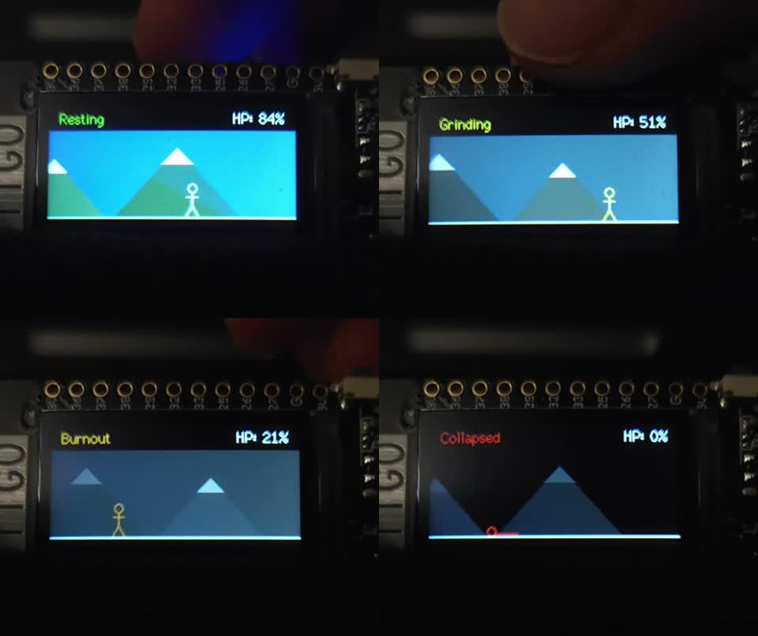

# Stick Man: Grinding and Burnout

Module 1 generative art project for COMS BC3930 Creative Embedded Systems. The sketch runs on a LilyGO TTGO T-Display ESP32 with an exposed wire connected to the capacitive touch pin.

## Video and photos

[Watch the hardware demo](https://github.com/user-attachments/assets/3be8f6ab-47e6-4042-87f7-cedefee3bc50)

[Read the Module 1 blog post](https://akitoyamauchi.com/courses/creative-embedded-systems/module-1/)

## Interaction

Holding the wire represents sustained external pressure. The figure runs faster while its health falls. At 30% health or below, it slows to a limp and the background darkens. Releasing the wire lets health recover slowly. At 0%, the figure collapses and stays still until the onboard button is pressed.

| State | Condition | Figure movement | Display |
| --- | --- | --- | --- |
| Resting | Wire released, health above 30% | 2 pixels per frame | White figure, blue sky, green mountains |
| Grinding | Wire touched, health above 30% | 4 pixels per frame | Yellow figure, muted sky and mountains |
| Burnout | Health above 0% and at or below 30% | 1 pixel per frame | Orange figure, dark sky and mountains |
| Collapsed | Health at 0% | Still | Red figure, black background |

## How the sketch works

- `calibration()` samples GPIO32 fifty times at startup and sets the touch threshold to 75% of the average. Leave the wire untouched during calibration. Pressing GPIO0 while the figure is active runs calibration again.
- Touch reduces health by 0.30 per loop, or 1.00 per loop during Burnout. Releasing touch restores 0.10 per loop, or 0.03 per loop during Burnout.
- The state is based on health after each update. Releasing the wire below 30% does not immediately return the figure to Resting.
- `drawMountains()` draws two mountain shapes with the same integer offset. The offset increases faster while the figure is Grinding. The shapes are drawn with TFT_eSPI primitives rather than stored image frames.
- Each frame clears the top text area before drawing the state and health labels.
- GPIO0 resets health to 100% after collapse. In other states it recalibrates the touch threshold.

## Hardware

| Part | Connection or role |
| --- | --- |
| LilyGO TTGO T-Display ESP32 | Runs the sketch and displays the animation |
| Exposed touch wire | GPIO32 |
| Onboard button | GPIO0 |
| ST7789 display | Built into the board |

## Build and run

1. Install the ESP32 board package and the TFT_eSPI library in Arduino IDE.
2. Configure `TFT_eSPI/User_Setup_Select.h` to include `User_Setups/Setup25_TTGO_T_Display.h`.
3. Open [`Project_1.ino`](Project_1.ino), select **ESP32 Dev Module** and the connected serial port, then upload.
4. Keep the touch wire released while the startup calibration runs.
